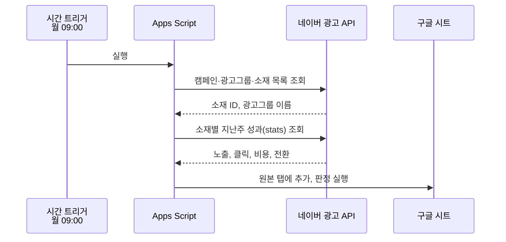

# 네이버 광고 성과 측정 지표 PRD

Sep 21, 2026 · @예진

> **2026-11-02 변경 이력**: 마케터가 **네이버 검색광고 API 키만 발급 가능**하다고 확인했다. 수집은 API 방식(6-1절)으로 진행한다. 키를 받기 전에는 보고서 업로드 방식(6-2절)을 대안으로 보류해 둔다. 0단계 조사 결과는 [STAGE0_FINDINGS.md](STAGE0_FINDINGS.md), 개발 진행은 [CHECKLIST.md](CHECKLIST.md)를 따른다.

## 1. 개요

네이버 광고 API로 소재별 성과를 매주 자동 수집해, 기준선보다 떨어진 디자인 소재를 알리고 AI 개선안 초안을 붙여 주는 도구를 만든다.

**배경**: 지금은 디자인 소재가 성과를 내는지 매출 숫자로만 짐작한다. 광고 성과 데이터는 마케터 계정에 있고, 디자이너가 직접 확인하기 어렵다. 검토한 플랫폼 중 공식 API로 광고 성과를 받을 수 있고 현실적으로 권한 협조가 가능한 곳이 네이버 광고여서 여기서 먼저 시작한다.

**목적**

1. 디자인이 직접 움직이는 지표(CTR, 전환율)로 소재 성과를 판정한다.
2. 마케터의 주간 수동 입력을 0분으로 만든다.
3. 기준 이하 소재를 월요일 오전에 알려 교체 결정을 앞당긴다.

**한 줄 요약**: 네이버 광고 API → 구글 시트 → 자동 판정 → 메일 알림과 AI 개선안, 모두 Apps Script로 구현한다.

## 2. 범위

Phase 1은 API로 수집하는 검색광고로 시작한다. 성과형 디스플레이는 공식 API 문서에 없어, Phase 2에서 보고서 업로드 등 다른 방식으로 붙이는 것을 검토한다.

| 구분 | 광고 상품 | 디자인과의 관련 | 포함 여부 |
| --- | --- | --- | --- |
| Phase 1 | 쇼핑검색광고 | 상품 썸네일 이미지가 곧 소재 | 포함 |
| Phase 1 | 파워링크 이미지형 확장소재 | 확장소재 이미지 | 포함 |
| Phase 1 | 파워링크 텍스트 소재 | 카피만 해당, 디자인 영향 적음 | 수집만, 판정 제외 |
| Phase 2 | 성과형 디스플레이(배너, 동영상) | 배너·영상 디자인 소재 | 보고서 업로드 방식으로 포함 검토 |
| 제외 | 스마트스토어 유입·체류 통계 | 광고 API 범위 밖 | 제외 (드롭 폴더로 별도 처리) |

2025년 9월 1일 검색광고와 성과형 디스플레이가 광고주센터로 통합되었고, 일부 성과형 디스플레이 리포트를 API로 받는 사례가 있다. 0단계 조사 결과, 공식 API 문서(searchad-apidoc)에는 성과형 디스플레이 API가 언급되지 않아 확인 불가이므로 Phase 2는 보고서 업로드 방식으로 검토한다.

## 3. 사용자와 역할

마케터는 API 키를 한 번 발급하고, 이후 반복 작업은 모두 자동이다.

| 담당 | 최초 1회 | 매주 반복 |
| --- | --- | --- |
| 디자이너 | 시트와 스크립트 설치, 작업물 ID 매핑 시트 작성 | 새 소재 게시 시 매핑 1줄 추가, 알림 확인 후 수정안 제작 |
| 마케터 | 광고주센터에서 API 키 발급(네이버 검색광고 API 키만 가능), 스크립트 속성에 입력(또는 디자이너에게 안전하게 전달) | 알림을 보고 소재 교체 여부 결정 |
| 자동 (Apps Script) | 없음 | 월요일 수집, 판정, 알림, AI 개선안 생성 |

## 4. 핵심 지표 정의

판정은 CTR 하나로 하고, 나머지는 원인을 좁히는 보조 지표로 쓴다.

| 지표 | 계산식 | API 필드 | 역할 |
| --- | --- | --- | --- |
| **CTR (판정 지표)** | 클릭수 ÷ 노출수 | clkCnt, impCnt | 썸네일·이미지가 눈에 띄고 클릭하고 싶게 만들었는가 |
| 전환율 | 전환수 ÷ 클릭수 | ccnt, clkCnt | 클릭 이후 상품·상세페이지가 설득했는가 |
| CPC | 광고비 ÷ 클릭수 | salesAmt, clkCnt | 같은 예산으로 얼마나 효율적으로 유입시켰는가 |
| ROAS | 전환매출 ÷ 광고비 | convAmt, salesAmt | 광고비 대비 매출 |
| 평균 노출 순위 | API 제공값 | avgRnk | CTR이 디자인 때문인지 순위 때문인지 구분 |

API 필드명은 0단계 조사로 확정했다([STAGE0_FINDINGS.md](STAGE0_FINDINGS.md)). 보고서 업로드 방식(대안)을 쓸 때는 보고서의 컬럼명을 기준으로 하며 샘플 보고서를 받은 뒤 매핑한다. 평균 노출 순위는 파워링크에만 의미가 있다(쇼핑검색은 순위 비교 안 함).

```latex
CTR = \frac{clkCnt}{impCnt} \qquad 판정비율 = \frac{소재\ CTR}{기준선\ CTR}
```

## 5. 판정 규칙

같은 광고 상품끼리의 평균 CTR을 기준선으로 삼고, 노출이 적거나 순위 차이가 큰 소재는 판정에서 따로 표시한다.

| 규칙 | 조건 | 결과 |
| --- | --- | --- |
| 기준선 | 같은 광고 상품(쇼핑검색 / 파워링크 확장소재) 소재의 최근 4주 평균 CTR | 상품별로 따로 계산 |
| 성공 | 소재 CTR ÷ 기준선 ≥ 1.2 | 성공 |
| 개선 필요 | 소재 CTR ÷ 기준선 ≤ 0.8 | 알림 대상 |
| 보통 | 그 사이 | 알림 없음 |
| 최소 노출 | 주간 노출수 1,000 미만 | 데이터 부족, 판정 제외 |
| 순위 영향 | 소재 평균 노출 순위가 기준선 소재 평균보다 2단계 이상 낮음 | 판정은 하되 순위 영향 가능 표시 |
| 소재 피로 | 3주 연속 CTR 하락, 첫 주 대비 20% 이상 감소 | 판정이 보통이어도 알림 |

±20%, 최소 노출 1,000, 순위 차 2단계는 초기값이다. 4주 운영 후 설정 탭에서 조정한다.

**판정 구현 기준 (3단계에서 확정한 해석)**

- 기준선 CTR은 같은 광고 상품 전체 소재(미매핑 소재 포함)의 해당 주 포함 최근 4주 합산 CTR(클릭 합 ÷ 노출 합)이다.
- 순위 기준선은 같은 기간의 노출 가중 평균 순위이다. 순위 값이 0이거나 없으면(쇼핑검색 등) 순위 영향은 비교하지 않는다.
- 소재 피로는 최근 3주 CTR이 매주 떨어지고 마지막 주가 첫 주보다 20% 이상 낮을 때이다. 3주 모두 최소 노출을 넘어야 한다. 주 수와 하락률은 설정 탭에서 바꾼다.
- 교체 매핑은 주 시작일 기준으로 `[게시일, 교체일)`에 속한 작업물 ID에 배정한다. 주중에 교체하면 그 주는 이전 작업물에 포함된다.
- 광고 상품별 기준선 소재가 5개 미만이면 판정은 하되 알림 유형을 비운다(비고에 사유 기록).
- 파워링크 텍스트 소재는 수집만 하고 판정하지 않는다.

## 6. 데이터 수집

### 6-1. API 방식 (채택)

매주 월요일 09:00에 Apps Script가 네이버 검색광고 API로 지난주(월\~일) 소재별 성과를 조회해 시트에 쌓는다.



| 항목 | 내용 |
| --- | --- |
| 인증 | API 키, 비밀키, 고객 ID. 요청마다 타임스탬프·메서드·경로로 HMAC-SHA256 서명 생성 |
| 조회 대상 | 캠페인 → 광고그룹 → 소재 목록 (ncc 계열 엔드포인트) |
| 성과 조회 | stats 엔드포인트, 소재 ID 묶음 + 지표 필드 + 지난주 기간 |
| 조회 기간 제한 | 1회 최대 92일. 주간 수집이라 문제없음 |
| 캠페인 이름 | 성과 응답에 이름이 없어 목록 조회 결과와 ID로 조인 |
| 수집 주기 | 매주 월 09:00, 지난주 월\~일 |
| 재수집 | 전환은 늦게 잡힐 수 있어 2주 전 데이터를 한 번 더 조회해 덮어쓰기 |

엔드포인트 경로와 필드명은 0단계 조사로 확정했다. 결과와 확인이 더 필요한 항목은 [STAGE0_FINDINGS.md](STAGE0_FINDINGS.md)에 정리했다.

### 6-2. 보고서 업로드 방식 (대안: 키를 받기 전, 또는 API가 막힐 때)

마케터가 매주 광고주센터에서 지난주(월\~일) 소재별 성과 보고서(CSV 또는 엑셀)를 내려받아 드라이브의 지정 폴더에 올리고, Apps Script가 새 파일을 읽어 `네이버_원본` 탭에 같은 컬럼으로 기록한다.

| 항목 | 내용 |
| --- | --- |
| 업로드 | 마케터가 매주 월요일 오전까지 보고서를 `네이버_보고서` 폴더에 올림 (일정은 마케터와 합의) |
| 처리 | 월요일 트리거가 새 파일을 읽어 원본 탭에 기록하고, 처리한 파일은 `처리완료` 하위 폴더로 이동 |
| 미업로드 | 정해진 시각까지 새 파일이 없으면 디자이너에게 안내 메일. 이전 주 데이터로 판정하지 않음 |
| 중복 방지 | 같은 기간·소재 ID 행은 덮어쓰기 (같은 보고서를 다시 올려도 안전) |
| 재수집 | 보고서 기간을 최근 2주로 내려받도록 요청해 늦게 잡힌 전환을 덮어쓰기로 반영 (마케터와 합의 필요) |
| 형식 검증 | 필수 컬럼(소재 ID, 노출수, 클릭수, 광고비, 전환수, 전환매출, 평균 노출 순위, 기간)이 없으면 오류 메일 |
| 보고서 컬럼 | **미정**. 마케터에게 샘플 보고서를 받은 뒤 컬럼명 기준으로 매핑을 확정한다 |

API 방식과 비교한 한계: 수집이 완전 자동이 아니라 마케터의 주 1회 업로드에 의존한다. 대신 광고 계정 권한이 필요 없다.

## 7. 작업물 ID 매핑

검색광고 소재에는 자유로운 이름 칸이 없으므로, 매핑 탭에서 네이버 소재 ID와 작업물 ID를 1:1로 연결한다.

| 방식 | 방법 | 채택 |
| --- | --- | --- |
| 매핑 탭 | 디자이너가 게시할 때 `작업물 ID / 네이버 소재 ID / 광고 상품` 한 줄 추가 | 기본 방식 |
| 광고그룹 이름 규칙 | 광고그룹 이름 앞에 작업물 ID (예: `BN_0920_A 추석 쇼핑검색`) | 보조. 마케터 동의 필요 |
| 자동 후보 제안 | 매핑이 없는 소재는 "미매핑" 목록에 올려 디자이너가 ID를 채우게 함 | 포함 |

쇼핑검색광고는 소재가 상품 단위이므로, 썸네일을 교체하면 같은 소재 ID라도 새 작업물 ID로 매핑하고 교체일을 적는다. 교체일 이전 성과는 이전 ID에 남긴다. 교체일은 월요일로 적고, 교체 후 새 행을 만들지 않으면 자동으로 미매핑에 표시된다. 상세 입력 규칙은 [MAPPING_RULES.md](MAPPING_RULES.md)를 따른다.

## 8. 시트 구조

구글 시트 한 파일에 6개 탭을 둔다. 원본은 스크립트만 쓰고, 사람은 매핑·설정 탭과 성과기록_배너 탭의 일부 열만 수정한다.

| 탭 | 작성 주체 | 컬럼 |
| --- | --- | --- |
| 네이버\_원본 | 스크립트 | 수집일, 기간시작, 기간종료, 광고 상품, 캠페인, 광고그룹, 소재 ID, 노출수, 클릭수, 광고비, 전환수, 전환매출, 평균 노출 순위 |
| 매핑 | 디자이너 | 작업물 ID, 네이버 소재 ID, 광고 상품, 게시일, 교체일, 메모 |
| 판정 | 스크립트 | 작업물 ID, 주차, CTR, 기준선, 판정비율, 판정, 전환율, CPC, ROAS, 순위 영향 여부, 3주 추이, 광고 상품, 알림 유형, 비고, 기준 전환율 |
| 알림\_로그 | 스크립트 | 발송일, 작업물 ID, 알림 유형, AI 개선안 전문, 발송 대상 |
| 설정 | 디자이너 | 성공 기준(20%), 개선 기준(20%), 최소 노출(1,000), 순위 차(2), 알림 수신자, AI 사용 여부, 기준선 주수(4), 피로 주수(3), 피로 하락률(20%), 알림 최소 소재 수(5) |
| 성과기록_배너 | 디자이너 + 스크립트 | 작업물 ID, 작업물 이름, (자동) 광고 상품~알림 유형, 조치, 조치일, 메모 |

성과기록_배너 탭은 기존 성과 기록 템플릿이 없어 임시로 만든 템플릿이다. 작업물 ID마다 한 줄로, 판정 탭의 최신 주 결과를 자동으로 채우고 이름·조치·메모는 디자이너가 쓴다. 상세는 [PERFORMANCE_LOG.md](PERFORMANCE_LOG.md). 기존 템플릿이 생기면 컬럼 대응만 바꾼다. 샘플 보고서 확인 결과는 [SAMPLE_REPORT_FINDINGS.md](SAMPLE_REPORT_FINDINGS.md).

## 9. 알림과 AI 개선안

월요일 11:00에 개선 필요와 소재 피로 소재만 모아 메일 한 통으로 보내고, 소재마다 AI 개선안 초안을 붙인다.

**알림 메일 구성**

1. 제목: `[네이버 광고 알림] 기준 이하 소재 N건 (9/14~9/20)`
2. 소재별 한 줄: 작업물 ID, 광고 상품, CTR과 기준선 대비 %, 순위 영향 표시
3. 소재별 규칙 기반 진단 한 줄 (예: 클릭 후 전환율은 기준 이상 → 썸네일 첫인상 문제)
4. AI 개선안 초안 (설정에서 AI 사용이 켜져 있을 때)
5. 판정 탭 링크

**AI 개선안**

- Apps Script에서 Claude API를 호출한다. 입력은 작업물 ID, 광고 상품, CTR·전환율·순위, 3주 추이, 규칙 기반 진단.
- 출력 형식: 원인 가설 1\~2문장, 수정 제안 3개, 다음 A/B 테스트 1개, 디자인 외 요인 의심 시 주의 1문장.
- 호출은 알림 대상 소재만. 주 5건 내외를 예상한다.
- 순위 영향 표시가 붙은 소재는 "입찰·순위 확인 먼저"를 주의 문장에 반드시 넣게 한다.

**발송 채널**: Phase 1은 메일(MailApp). 알림 대상이 없는 주에는 메일을 보내지 않고 알림_로그에만 기록한다. Slack·Teams 웹훅은 채널 관리자가 주소를 발급해 주면 추가한다.

### 보고서 화면

시트 메뉴에서 보고서를 두 가지 형태로 보여 준다. 상세는 [REPORT.md](REPORT.md).

- **그래프 보고서**: 판정 분포, 주차별 CTR 추이(기준선 대비), 작업물별 CTR과 기준선을 수치와 함께 표시한다. 주차와 광고 상품으로 바꿔 볼 수 있다.
- **일반 보고서**: 문서 형태(요약, 광고 상품별 기준선, 알림 대상과 진단, 전체 작업물, 미매핑 소재). 그래프 화면의 버튼을 누르면 **서브 창**으로 뜬다.

## 10. 비기능 요구사항

API 키는 시트나 코드에 적지 않고, 실패하면 반드시 알린다.

| 영역 | 요구사항 |
| --- | --- |
| 보안 | 네이버 API 키·비밀키·고객 ID와 Claude API 키는 스크립트 속성(PropertiesService)에만 저장. 시트 공유 대상에 노출 금지 |
| 권한 | 스크립트는 조회용 엔드포인트(GET)만 호출. 광고 생성·수정·입찰 변경 호출 금지 |
| 실행 시간 | Apps Script 1회 실행 최대 6분. 소재가 많으면 수집·판정·알림을 트리거 3개로 분리 |
| 호출 제한 | 요청 사이 짧은 대기, 429 응답 시 재시도 3회 |
| 오류 처리 | 수집 실패 시 디자이너에게 오류 메일 1통, 알림\_로그에 기록. 판정은 이전 주 데이터로 돌리지 않음 |
| 중복 방지 | 같은 기간·소재 ID 행은 덮어쓰기 |
| 개인정보 | 고객 정보 없음. 광고 성과 수치만 저장 |

## 11. 성공 기준

운영 4주 차에 아래 4가지를 확인해 Phase 2 진행 여부를 정한다.

| 기준 | 목표 |
| --- | --- |
| 마케터 주간 수동 입력 | 0분 |
| 자동 수집 성공 | 4주 중 4회 |
| 매핑률 (작업물 ID가 붙은 소재 비율) | 판정 대상 소재의 90% 이상 |
| 알림 활용 | 알림 소재 중 1건 이상이 교체 또는 A/B 테스트로 이어짐 |

## 12. 리스크와 대응

가장 큰 리스크는 CTR이 디자인보다 순위와 키워드에 더 흔들린다는 점이며, 순위 영향 표시로 대응한다.

| 리스크 | 영향 | 대응 |
| --- | --- | --- |
| 검색광고 CTR이 순위·키워드에 좌우됨 | 디자인 탓이 아닌데 개선 필요로 판정 | 평균 노출 순위 비교, 순위 영향 표시, 같은 광고 상품끼리만 비교 |
| API 키 발급 협조 지연 | 착수 불가 | 발급 전까지 코드는 키 없이 가능한 부분만 먼저 개발, 급하면 보고서 다운로드 + 드롭 폴더(6-2) |
| 확장소재 성과가 `/stats`로 조회되지 않을 수 있음 | 파워링크 이미지 확장소재 수집 불가 | STAT-REPORT `ADEXTENSION` 보고서(비동기)로 전환, 쇼핑검색만 먼저 운영 |
| 성과형 디스플레이 API 문서 없음 | Phase 2 방식 미정 | Phase 1만으로 운영 가능하게 설계, Phase 2는 보고서 업로드 방식으로 검토 |
| API 사양 변경 | 수집 중단 | 오류 메일 즉시 발송, 필드명을 설정 상수로 분리 |
| 매핑 누락 | 판정 불가 소재 발생 | 미매핑 목록을 알림 메일 하단에 포함 |
| 적은 데이터로 기준선 불안정 | 판정 신뢰도 낮음 | 광고 상품별 소재 5개 이상 쌓이기 전에는 알림 끔 |

## 13. 일정과 마일스톤

5주 안에 Phase 1 자동 알림까지 운영하는 것을 목표로 한다. 날짜는 착수일에 맞춰 조정한다.

| 주차 | 마일스톤 | 완료 조건 |
| --- | --- | --- |
| 1주차 | API 키 발급, 인증 연결 | 캠페인 목록이 로그에 출력됨 |
| 2주차 | 소재 목록·성과 수집, 원본 탭 기록 | 지난주 소재별 노출·클릭이 시트에 쌓임 |
| 3주차 | 매핑 탭, 판정 로직, 주간 트리거 | 판정 탭 자동 갱신 |
| 4주차 | 메일 알림, 오류 메일 | 월요일 11:00 알림 수신 |
| 5주차 | Claude API 개선안, 성공 기준 점검 | 알림에 AI 개선안 포함, Phase 2 결정 |

## 14. 개발 체크리스트

> 최신 체크리스트는 [CHECKLIST.md](CHECKLIST.md)가 기준이다. 아래 목록은 최초 작성본이다.

위에서부터 순서대로 진행하며, 각 단계의 마지막 항목이 다음 단계로 넘어가는 조건이다.

**0단계: 사전 준비**

- [ ] 마케터에게 API 사용 목적과 조회 전용임을 설명하고 협조 요청
- [ ] 광고주센터에서 API 키, 비밀키, 고객 ID 발급 (마케터)
- [ ] 공식 API 문서에서 stats 지표 필드명, 소재 목록 엔드포인트 확인
- [ ] 성과형 디스플레이 API 지원 범위 확인 (Phase 2 판단용)

**1단계: 시트와 인증**

- [ ] 구글 시트 생성, 5개 탭(네이버\_원본, 매핑, 판정, 알림\_로그, 설정) 만들기
- [ ] 확장 프로그램 → Apps Script 프로젝트 생성
- [ ] 스크립트 속성에 API 키·비밀키·고객 ID 저장
- [ ] HMAC-SHA256 서명 함수 작성 (Utilities.computeHmacSha256Signature)
- [ ] 캠페인 목록 조회 테스트, 로그 출력 확인

**2단계: 수집**

- [ ] 광고그룹·소재 목록 조회, 소재 ID와 광고그룹 이름 표 만들기
- [ ] 지난주 기간(월\~일) 자동 계산 함수
- [ ] 소재 ID 묶음으로 stats 조회, 노출·클릭·비용·전환·순위 수집
- [ ] 목록과 성과를 소재 ID로 조인해 원본 탭에 기록
- [ ] 같은 기간·소재 중복 시 덮어쓰기
- [ ] 2주 전 데이터 재조회로 늦게 잡힌 전환 반영
- [ ] 429·5xx 응답 재시도 3회

**3단계: 매핑과 판정**

- [ ] 매핑 탭 입력 규칙 정리, 기존 쇼핑검색 소재부터 매핑
- [ ] 미매핑 소재 목록 자동 생성
- [ ] 광고 상품별 4주 평균 CTR 기준선 계산
- [ ] 최소 노출 1,000 미만 데이터 부족 처리
- [ ] 성공 / 보통 / 개선 필요 판정
- [ ] 평균 노출 순위 비교, 순위 영향 표시
- [ ] 3주 추이로 소재 피로 판정
- [ ] 설정 탭 값으로 기준을 읽도록 연결

**4단계: 트리거와 알림**

- [ ] 시간 트리거 등록: 월 09:00 수집, 10:30 판정, 11:00 알림
- [ ] 알림 메일 본문 템플릿 (제목, 소재별 한 줄, 진단, 미매핑 목록, 시트 링크)
- [ ] MailApp 발송, 수신자는 설정 탭에서 읽기
- [ ] 수집 실패 시 오류 메일과 알림\_로그 기록
- [ ] 한 주 동안 테스트 수신자에게만 발송해 검증

**5단계: AI 개선안**

- [ ] Claude API 키를 스크립트 속성에 저장
- [ ] 프롬프트 작성 (입력 항목, 출력 형식, 순위 영향 시 주의 문장)
- [ ] 알림 대상 소재만 호출, 결과를 알림\_로그에 저장
- [ ] API 오류 시 AI 개선안 없이 알림은 정상 발송

**6단계: 운영 점검**

- [ ] 4주 운영 후 성공 기준 4개 점검
- [ ] 판정 기준값(±20%, 최소 노출, 순위 차) 조정
- [ ] 마케터에게 결과 공유, Phase 2(성과형 디스플레이) 진행 결정
