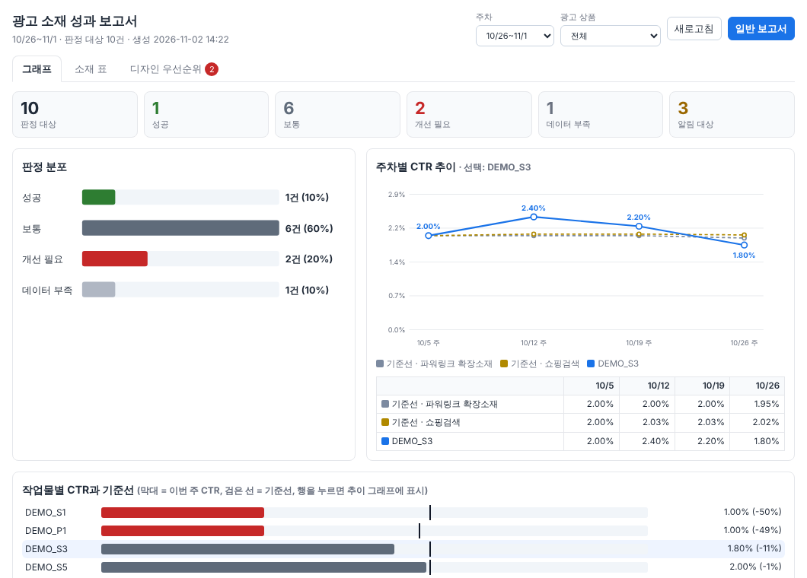
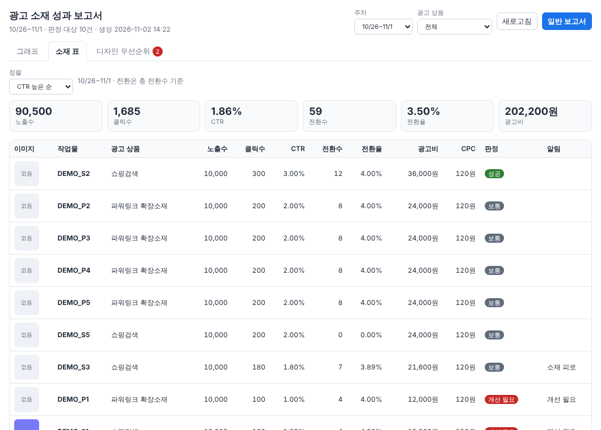
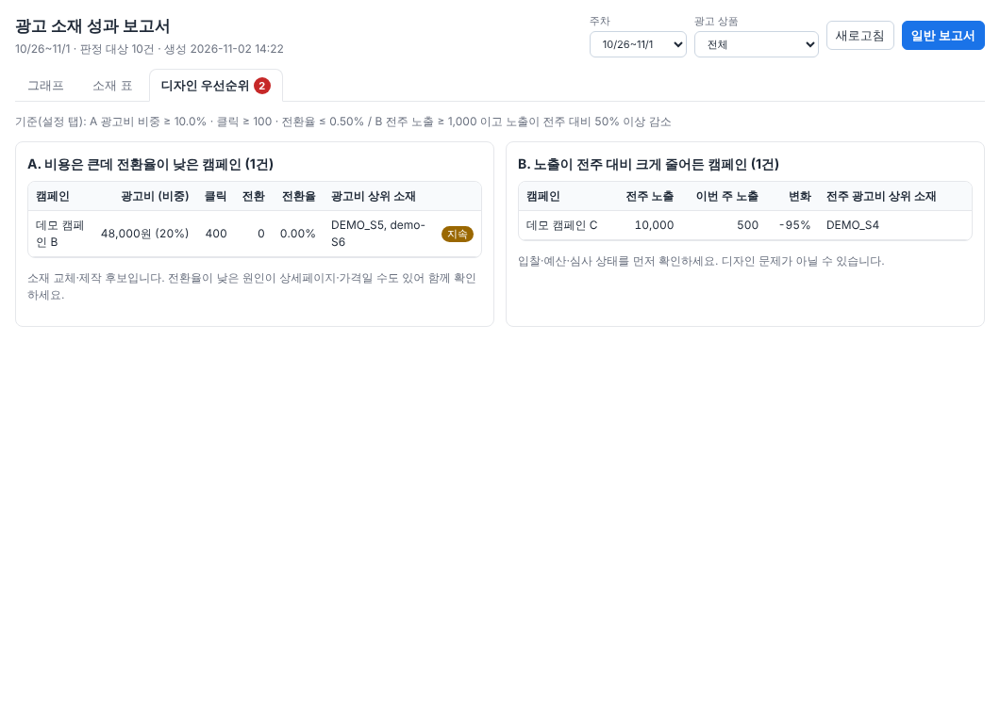
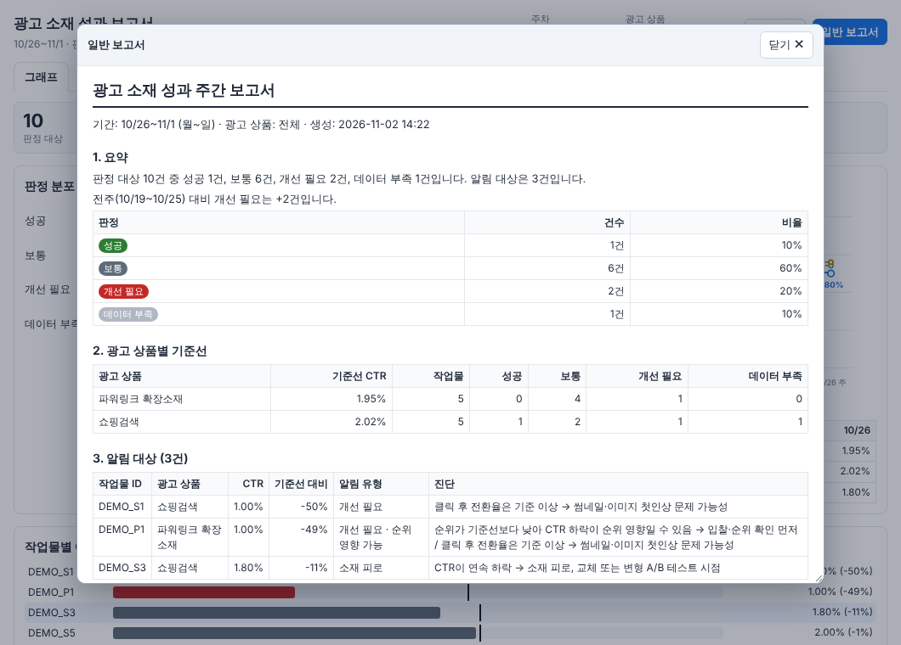

# 보고서 화면

시트 메뉴 **네이버 광고 → 11. 보고서 보기**로 엽니다. 위쪽 탭 세 개와 서브 창으로 구성됩니다.

1. **그래프**: 수치가 함께 표시되는 그래프 화면 (기본으로 열림)
2. **소재 표**: 작업물별 노출·클릭·CTR·전환·광고비 한 표 (이미지 포함)
3. **디자인 우선순위**: 교체·제작 후보 캠페인
4. **일반 보고서**: 문서 형태. 위쪽 **[일반 보고서]** 버튼을 누르면 **서브 창**으로 뜹니다.

판정 탭이 비어 있으면 "먼저 판정을 실행해 달라"는 안내가 나옵니다. 키 없이 보려면 `9. 데모 데이터 넣기` → `5. 판정 실행` → `11. 보고서 보기` 순서로 하세요.

## 그래프

| 영역 | 보여 주는 것 | 수치 표시 |
| --- | --- | --- |
| 상단 숫자 카드 | 판정 대상, 성공, 보통, 개선 필요, 데이터 부족, 알림 대상 | 건수 |
| 판정 분포 | 판정별 막대 | `6건 (60%)` |
| 주차별 CTR 추이 | 광고 상품별 기준선(점선)과 선택한 작업물(실선) | 작업물 점마다 CTR, 그래프 아래 표에 기준선·작업물의 주차별 값 |
| 작업물별 CTR과 기준선 | 막대 = 이번 주 CTR, 검은 선 = 기준선. 기준선 대비가 낮은 순 | `1.00% (-50%)`, 데이터 부족은 별도 표시 |

- 위쪽 **주차**와 **광고 상품** 선택으로 화면 전체가 바뀝니다.
- 작업물 행을 누르면 추이 그래프에 그 작업물이 표시됩니다.
- 막대와 점에 마우스를 올리면 자세한 수치가 말풍선으로 나옵니다.
- **새로고침**은 판정 탭의 최신 값을 다시 불러옵니다.

## 소재 표

작업물별 이미지, 노출수, 클릭수, CTR, 전환수, 전환율, 광고비, CPC, 판정, 알림을 한 표로 보여 줍니다. 전환은 **총 전환수** 기준이고, 주차·광고 상품 필터와 정렬(노출·CTR·전환·광고비)을 쓸 수 있습니다. 맨 아래 합계 행과 위쪽 숫자 카드는 표시된 행의 합입니다.

- 이미지는 매핑 탭의 `이미지 URL`에서 가져옵니다. 주소가 없거나 불러오지 못하거나 `http(s)`가 아니면 "없음" 칸으로 표시합니다.
- 같은 내용이 시트의 `소재_주간리포트` 탭에 최신 주 기준으로 정리됩니다(광고 상품별 소계와 합계 포함, 판정 실행 때 갱신).

## 디자인 우선순위

소재를 새로 만들거나 교체할 후보 캠페인입니다. 기준값은 설정 탭 값이고 화면 맨 위에 표시됩니다.

- **A. 비용은 큰데 전환율이 낮은 캠페인**: 광고비 비중 ≥ 10%, 클릭 ≥ 100, 전환율 ≤ 0.5% (초기값).
- **B. 노출이 전주 대비 크게 줄어든 캠페인**: 전주 노출 ≥ 1,000이고 노출이 50% 이상 감소. 입찰·예산·심사 상태를 먼저 확인합니다.
- 같은 캠페인이 전주에도 걸렸으면 `지속`으로 표시하고, 캠페인 안에서 광고비가 큰 소재 상위 3개를 함께 보여 줍니다.
- 탭 이름의 빨간 숫자는 후보 건수입니다. 같은 내용이 주간 알림 메일의 "디자인 우선순위" 섹션에도 들어갑니다.
- 이 계정의 샘플 데이터에서는 규칙 A가 걸리지 않았습니다 ([SAMPLE_REPORT_FINDINGS.md](SAMPLE_REPORT_FINDINGS.md) 4절).

## 일반 보고서 (서브 창)

**[일반 보고서]** 버튼을 누르면 같은 화면 위에 서브 창이 뜹니다. 선택한 주차와 광고 상품 기준입니다.

1. 요약: 판정 건수 문장, 전주 대비 개선 필요 증감, 판정별 표
2. 광고 상품별 기준선: 기준선 CTR과 판정별 작업물 수
3. 알림 대상: 작업물, CTR, 기준선 대비, 알림 유형, 규칙 기반 진단
4. 전체 작업물: CTR, 기준선, 판정, 전환율, CPC, ROAS, 3주 추이
5. 미매핑 소재: 작업물 ID를 채워야 할 소재

서브 창은 제목 줄을 끌어 옮길 수 있고, 모서리를 끌어 크기를 바꿀 수 있습니다. **닫기**, `Esc`, 창 밖 클릭으로 닫습니다. 닫으면 그래프 화면은 그대로 남아 있습니다.

## 설치

Apps Script에 `Report.gs`와 HTML 파일 `ReportGraph`를 추가합니다 ([SETUP.md](SETUP.md)). HTML 파일은 **파일 `+` → HTML**로 만들고 이름을 `ReportGraph`로 합니다(`.html`은 자동으로 붙습니다). 매니페스트의 `script.container.ui` 권한이 필요합니다(`appsscript.json`에 포함).

## 한계

- 대화상자는 시트 안에서 열리는 창입니다. 시트를 닫거나 새로고침하면 닫힙니다.
- 보고서는 판정 탭의 값을 보여 줄 뿐 직접 계산하지 않습니다. 최신 결과를 보려면 먼저 판정을 실행하세요.
- 일반 보고서에는 인쇄·PDF 내보내기가 없습니다. 필요하면 서브 창 내용을 복사해서 쓰세요.
- 화면과 서브 창은 Apps Script 대화상자(iframe) 안에서 도는 코드입니다. 이 저장소의 테스트는 실제 브라우저(Chromium)로 화면을 열어 수치와 동작을 확인하지만, 구글 시트 안에서 열리는 모습은 직접 확인이 필요합니다.
